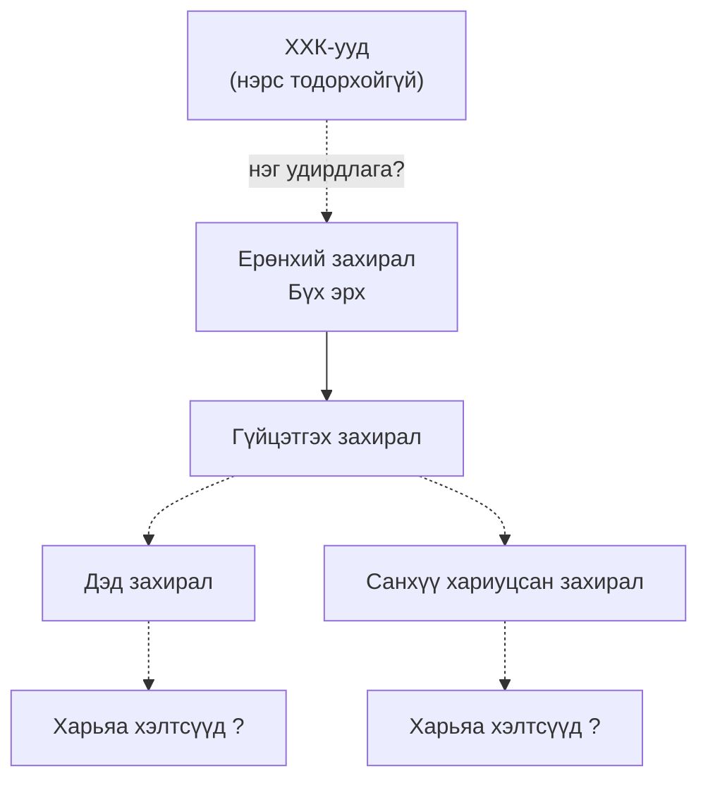

# Компанийн бүтэц

**Хувилбар 1 · 2026-10-28 · Төсөл, батлагдаагүй**

Харагдах хувилбар (зөвхөн эзэмшигч нээнэ): https://claude.ai/artifact/9qqisX4YznSZvJGN8oHpGn

Тасархай шугам бол таамаг. Захирлуудын харьяаллыг хэрэглэгчийн жагсаасан дарааллаар зурсан.

## Хэрэглэгчийн хэлсэн

- Албан тушаалууд: Ерөнхий захирал, Гүйцэтгэх захирал, Дэд захирал, Санхүү хариуцсан захирал, дараа нь хэлтсүүд.
- Хэд хэдэн ХХК байна. ХХК бүр тусдаа. Нэг ажилтан хэд хэдэн ХХК-д харьяалагдаж болно.
- Ажилтан бүр өөрийн бүртгэлээр нэвтэрнэ.
- Том админ буюу захирал бүх эрхтэй.

## Санал (батлагдаагүй)

- Хэд хэдэн ХХК-д харьяалагддаг ажилтан нэвтэрсний дараа аль ХХК-д ажиллахаа сонгоно.
- Бусад ажилтны эрхийг албан тушаал, хэлтсээр нь тохируулна.

## Тодруулах асуултууд

1. **ХХК-ууд.** Хэдэн ХХК байгаа вэ, нэрс нь юу вэ?
2. **Удирдлага.** Дээрх 4 захирал бүх ХХК-д нэг үү, эсвэл ХХК бүр өөрийн захиралтай юу?
3. **Харьяалал.** Дэд захирал, Санхүү хариуцсан захирал хоёулаа Гүйцэтгэх захиралд харьяалагддаг уу?
4. **Хэлтсүүд.** Ямар хэлтсүүд байгаа вэ, аль нь аль захиралд харьяалагддаг вэ?
5. **Бүх эрх.** Бүх эрхтэй хүн зөвхөн Ерөнхий захирал уу?
6. **Олон ХХК.** Нэг ажилтан өөр өөр ХХК-д өөр албан тушаал хашиж болох уу?
